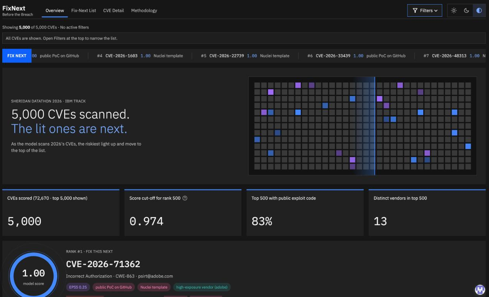
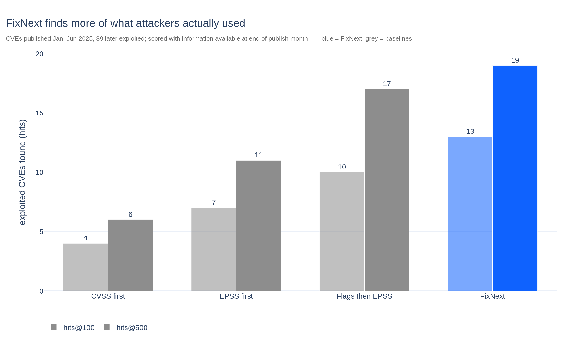
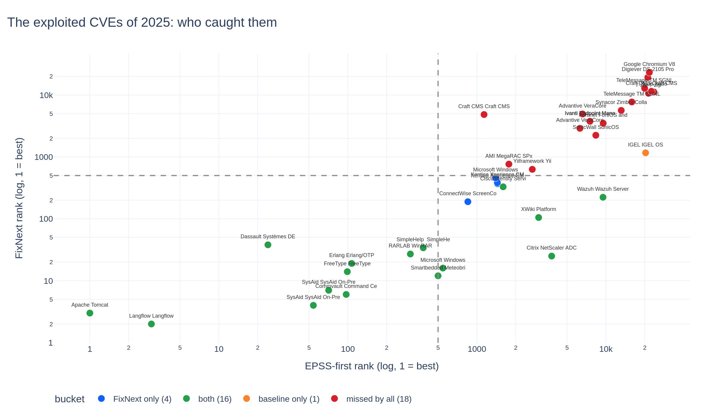
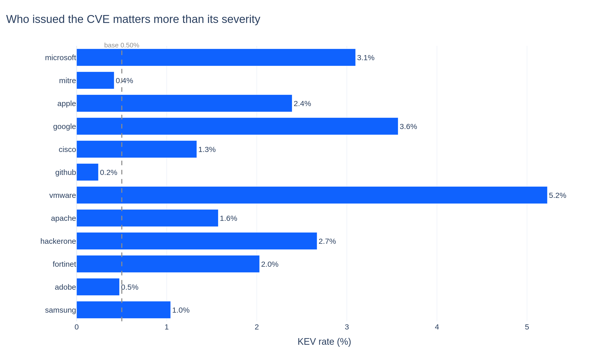
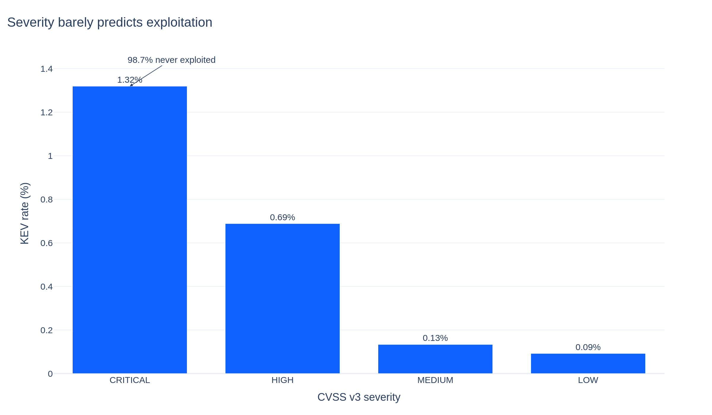
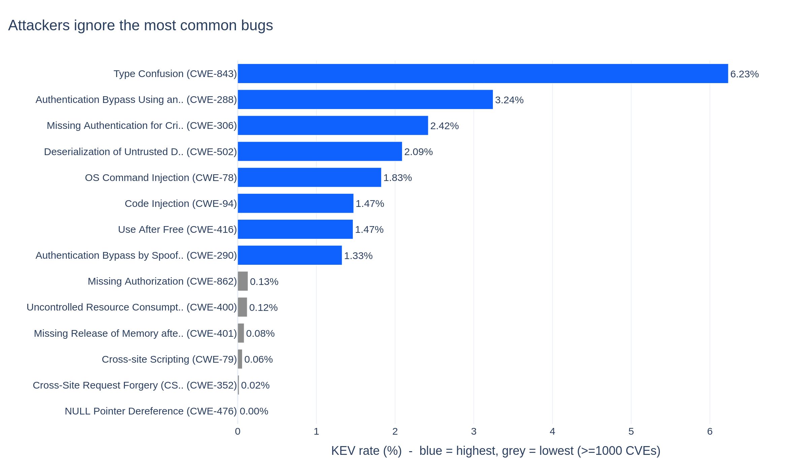
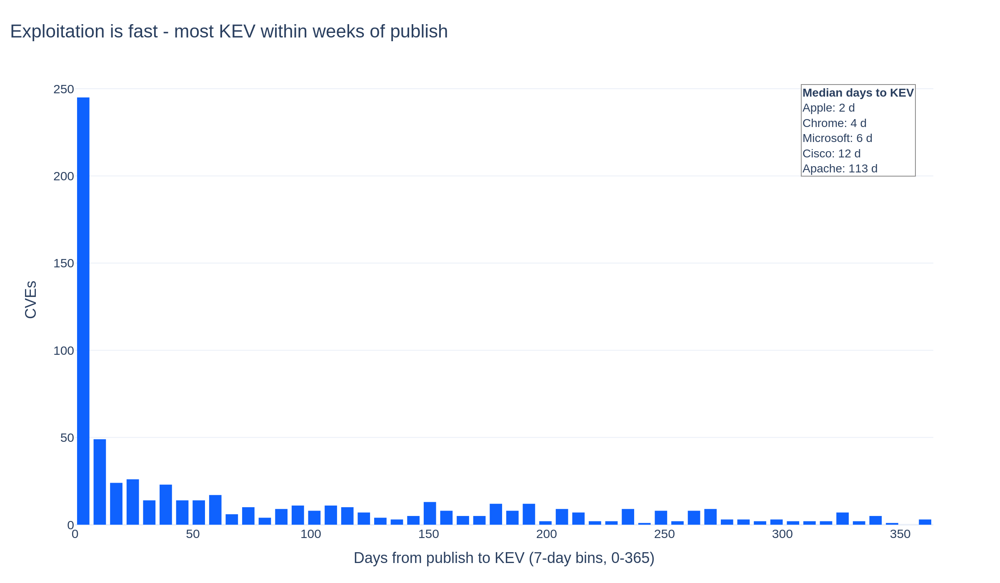
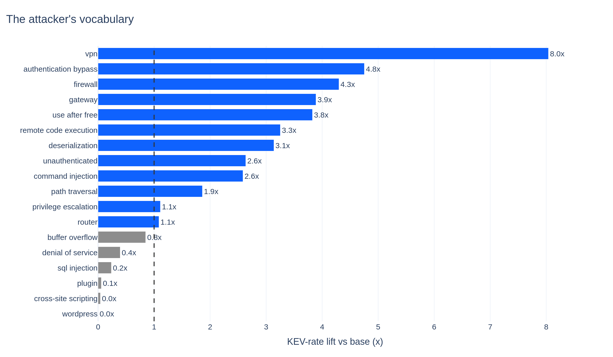

<div align="center">

# 🛡️ FixNext — Before the Breach

**Which of 2026's 72,670 vulnerabilities will attackers actually use — so you know what to fix next.**

[](https://fixnext.streamlit.app)
[](https://fixnext.select)


<a href="https://fixnext.streamlit.app"></a>

*Team: Hossam · David · Antesh · Calvin* · **Model card for judges → [outputs/MODEL_CARD.md](outputs/MODEL_CARD.md)** · **Demo video → [youtu.be/ml9asW7tW0Q](https://youtu.be/ml9asW7tW0Q)**

</div>

---

## 🎯 The problem
92,205 vulnerabilities were published in 2026 so far — more than double all of 2024. Fewer than **1 in 250** is ever confirmed to be used by attackers. Security teams rank by CVSS severity, which measures how bad an attack *could* be, not whether anyone will bother.

**FixNext** ranks every 2026 CVE by how likely attackers are to actually use it, using only what was known at the end of its publish month: the description (read by **IBM Granite**), who issued it, the weakness type, the CVSS vector and the public exploit signals. For every CVE it gives the score, the reasons, the three already-exploited CVEs it most resembles, and — for the top 100 — a two-line *"why fix this next"* written by a Granite language model.

## 📊 Results — tested honestly in time
Train on CVEs published in 2024 → predict which CVEs published Jan–Jun 2025 were later added to CISA's Known Exploited Vulnerabilities list (39 were).

| Ranking | Exploited CVEs found in top 100 | in top 500 |
|---|:---:|:---:|
| CVSS v3 score first | 4 | 6 |
| EPSS first | 7 | 11 |
| Public exploit code first, then EPSS | 10 | 17 |
| **FixNext** | **15** | **19** |
| FixNext without "exploited"/"in the wild" keywords (ablation) | 9 | 15 |

<p align="center"></p>

**Named catches the standard scores buried:** ConnectWise ScreenConnect, two Kentico Xperience auth bypasses, a Windows NTLM hash leak — all with near-zero EPSS and no exploit code when published, all later exploited. We also list the 18 nobody caught.

<p align="center"></p>

Final rule: blend of LightGBM (TF-IDF text + CWE + assigner + CVSS vector + exploit signals + **IBM Granite nearest-exploited-CVE similarity**) with the exploit-code-then-EPSS ranking. Full ablations — including Granite PCA and five-year history features that did *not* help — in [outputs/backtest.md](outputs/backtest.md). **Our #1 pick for 2026, CVE-2026-71362, was added to CISA KEV on 2026-09-24** (checked after the model was frozen).

## 🔍 What we found
All figures live in [outputs/charts/](outputs/charts/).

**Microsoft alone = 19.6% of all KEV** — who issued the CVE beats how severe it is.


**98.7% of CRITICAL CVEs are never exploited** (CRITICAL KEV rate 1.32%).


**XSS (CWE-79): 15 of 25,755 exploited** — attackers ignore the most common bug types.


**Median 28 days from publish to KEV** — exploitation is fast.


**Internet-edge + auth-bypass + RCE words raise the odds; XSS/WordPress near zero.**



## 🧠 IBM technology (Granite)
- ibm-granite/granite-embedding-small-english-r2 embeds every CVE description (180,308 vectors, Colab GPU). For each CVE we compute its cosine similarity to CVEs already on CISA KEV at that time — this "resembles a known-exploited CVE" signal is the model's #4 feature (gr_knn_max). Used as PCA features instead, Granite did not beat TF-IDF on 39 validation positives; both results are in outputs/backtest.md.
- ibm-granite/granite-3.3-2b-instruct writes the two-line "why fix this next" rationale for every CVE in the top 100 (outputs/rationales*.csv), shown in the dashboard.
- Notebook: notebooks/granite_embed_and_explain.ipynb (embeddings + rationales, with outputs).

## 🛡️ Keeping it fair — columns used
Allowed (known at publish / end of snapshot month): `description`, `assigner`, `published`, `cwe_ids`, CVSS v3 score and vector components, and the scoreboard's `epss`, `exploitdb`, `metasploit`, `nuclei`, `poc_github`. Labels come from `known_exploited.csv` (≤ 2025-12-31) for training only.

**Not used for 2026 features:** `nvd_status`, `n_references`, `n_affected_cpes`, `last_modified`, `cvss3_source`, `references.csv`, `affected_products.csv` — NIST fills these in after attacks, so they leak the answer. `src/config.py::assert_no_leakage` enforces this.

## 🖥️ The dashboard
Live at **[fixnext.streamlit.app](https://fixnext.streamlit.app)** (Streamlit Community Cloud, rebuilt from `main`) and **[fixnext.select](https://fixnext.select)** (our domain — GitHub Pages running the same app in the browser with [stlite](https://github.com/whitphx/stlite), no server).

| Page | What it answers |
|---|---|
| **Overview** | The showcase stage: each exploited CVE of 2025 that the standard scores buried, told as a story (day 0 → what FixNext saw → the day it was exploited → verdict); put any CVE of the top 500 on the stage. Then the result in numbers, the filterable back-test chart (where CVSS / EPSS / exploit-code / FixNext put each of the 39 exploited CVEs), who and what dominates the top 500, and the four named catches. |
| **Fix-Next List** | The ranked list with filters — quick picks ("EPSS would miss these", "Critical but EPSS < 1%"…), rank and EPSS ranges, severity, vendor, weakness type, month — and the one-click `top500.csv` download. |
| **CVE Detail** | One CVE: its rank under every method, how the model reads it (issuer, weakness, Granite similarity, exploit code, EPSS), the three exploited CVEs it resembles, the Granite rationale, the NVD link. |
| **Methodology** | How it was tested, what it uses, and what it refuses to use. |

### Google Gemini in the dashboard
Gemini does three jobs, all grounded in FixNext's own data (the ranking, the signals, the back-test, the findings) and none of them touches the ranking itself:

| Where | What Gemini does | How |
|---|---|---|
| Every page — **Ask FixNext** (floating pill) | Answers questions about the project and about the CVE on screen, from our numbers only; says "that isn't in FixNext's data" otherwise | `gemini-2.5-flash` via `google-genai`, system rules + project/CVE context, thinking off |
| CVE Detail — **Draft the fix ticket** | Turns the CVE's signals into a ticket: P1/P2/P3, owner, due date, why now, actions, open question — downloadable as Markdown for Jira / GitHub issues | structured output (`response_schema`, JSON) |
| Fix-Next List — **Monday briefing** | Writes the week's patch briefing for whatever the filters currently show (top 5 to fix with reasons, what EPSS would miss, a caveat); flags itself stale when the filters change | structured output; reads the live filter state |

It needs a Gemini API key: on Streamlit Cloud it is a secret (`GEMINI_API_KEY` in the app's Secrets), locally an environment variable; the key is never in this repository. fixnext.select runs in the browser without secrets, so the three Gemini features hide themselves there by design.

The showcase stage is three.js (loaded from jsDelivr) inside a Streamlit iframe; everything else is Streamlit + Plotly + hand-written SVG. Light and dark themes (switch top-right). All dashboard data is the frozen ranking in `app/` — no live feeds, no model calls at run time.

## 🚀 Quick start — the dashboard (3 commands, no data download needed)
```bash
git clone https://github.com/DavidRosales21/FixNext.git && cd FixNext
python -m pip install -r requirements.txt
python -m streamlit run app/app.py
```
Opens at http://localhost:8501 with the frozen 2026 ranking (app/ranked_light.csv). To enable Ask FixNext locally: `GEMINI_API_KEY=<your key> python -m streamlit run app/app.py`.

## 🔁 Reproduce the full pipeline (needs the 850 MB data.zip from the track + Granite embeddings)
See [data/README.md](data/README.md) for what goes in `data/` (the track's data.zip files and the Granite embedding outputs).
```bash
python -m pip install -r requirements.txt
python -m src.build_features        # CSVs → outputs/features.parquet (one row per CVE)
python -m src.train                 # train + back-test → outputs/top500.csv, backtest.md, ranked_2026.csv
python scripts/check_top500.py      # validate the submission format
python -m src.discovery             # the 5 discovery findings → outputs/charts/ (charts + tables)
python -m src.history_rates         # strictly pre-2024 exposure-rate features → outputs/history/
python -m src.caught_vs_missed      # exploited CVEs we caught vs missed on the 2025 hold-out → chart 6
python -m src.results_charts        # FixNext vs baselines + top-500 profile → charts 7, 8
python -m src.make_app_data         # light browser data for the dashboard → app/ranked_light.csv, app/backtest.csv
python -m streamlit run app/app.py  # launch the dashboard on the reproduced data
```

## 🗂️ Layout
```
data/        IBM track CSVs + Granite outputs (not committed — see data/README.md)
src/         pipeline: config.py (paths + leakage rules) · build_features.py · train.py
scripts/     check_top500.py — validates the submission file
notebooks/   granite_embed_and_explain.ipynb — Colab, IBM Granite
outputs/     top500.csv · ranked_2026.csv · backtest.md · MODEL_CARD.md · similar_exploited.csv · rationales.csv · rationales_2.csv · charts/ · history/
app/         Streamlit dashboard: app.py · ranked_light.csv (top 5,000 of the ranking, 26 columns) · backtest.csv · catches.csv (the 20 caught) ·
             exploited_2025.csv (the 39 exploited CVEs of the hold-out with their rank under each method) · profile.json (top-500 facts) · .streamlit/config.toml (theme) · static/ (IBM Plex fonts)
docs/        dashboard.png (README hero image)
tests/       pytest
```

## 🤝 How we worked
Branch per task, pull request into main, every PR reviewed against the leakage rules in src/config.py before merge. data/ is git-ignored; raw files came from the track's data.zip, Granite outputs from Colab.

## 🙏 Credits
NIST National Vulnerability Database (fkie-cad/nvd-json-data-feeds mirror, 2026-11-06) · CISA Known Exploited Vulnerabilities catalog (to 2025-12-31) · EPSS (FIRST) · public exploit flags from t0sche/cvss-bt (Exploit-DB, Metasploit, Nuclei, GitHub) · MITRE CWE v4.14 · IBM Granite (Hugging Face) · Google Gemini (Ask FixNext) · Streamlit Community Cloud (hosting) · GoDaddy Registry (fixnext.select) · three.js · Archivo (Google Fonts).

Demo video: (link added Sunday)
